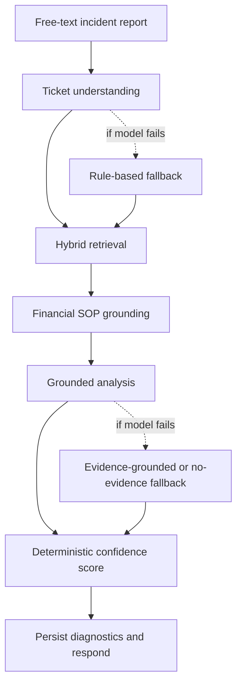
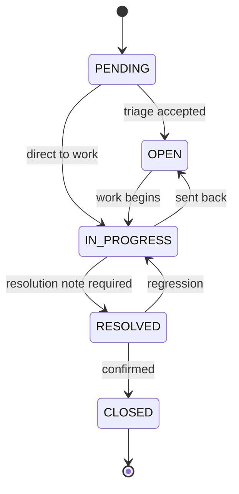

# BugPilot — AI-Assisted ERP Support Ticket Triage

BugPilot is an enterprise-style support ticketing platform for ERP incidents. It helps a support team turn an unstructured incident report into a reviewable triage assessment by combining historical ticket evidence, governed financial SOPs, and a locally hosted language model. It also provides the ticket lifecycle, role-based access, department-scoped views, analytics, and PDF exports needed to carry an issue through to an audited resolution.

The goal is not to let AI make operational decisions on its own. BugPilot gives the engineer a structured starting point, shows the evidence behind it, records the analysis mode and confidence explanation, and leaves the final decision with the human responsible for the ticket.

## What it does

- **Ticket management:** create and search tickets, view history, assign work, and track status through a controlled lifecycle.
- **Role-based access control:** authenticate users with JWT sessions and enforce role and department scope on the server.
- **AI-assisted triage:** turn a free-text report into a structured understanding of the issue, then retrieve relevant historical incidents and financial SOPs.
- **Hybrid retrieval:** combine SQLite FTS5/BM25 keyword search with Sentence Transformer embeddings stored in Chroma; merge ranked candidates with Reciprocal Rank Fusion.
- **Grounded analysis:** return an analysis, likely cause, severity, numbered resolution suggestions, supporting evidence, and missing-information prompts.
- **Confidence and diagnostics:** calculate a deterministic confidence score and store retrieval diagnostics and the analysis mode.
- **Analytics:** review role-scoped ticket totals and day/week/month trends.
- **PDF export:** create a formatted report that can be retained with change records or audit material.
- **Graceful degradation:** label fallback behaviour clearly when a model or retrieval stage is unavailable instead of presenting a fallback as a full AI result.

## Technology overview

| Area | Technology | Responsibility |
|---|---|---|
| Frontend | React 19, Vite, React Router, Axios, Lucide | Single-page application, navigation, API calls, and interface |
| API | FastAPI, Uvicorn, Pydantic | REST endpoints, request validation, authentication, authorization |
| Identity | JWT/HS256, PBKDF2-SHA256 | Signed sessions and password hashing |
| Orchestration | LangGraph | Explicit, inspectable stages for ticket analysis |
| Local model | Ollama + llama3.2 | Local language-model inference |
| Embeddings | Sentence Transformers, all-MiniLM-L6-v2 | Semantic representations for retrieval |
| Keyword search | SQLite FTS5 / BM25 | Lexical retrieval over indexed ticket content |
| Vector search | Chroma HNSW | Semantic nearest-neighbour retrieval |
| Persistence | SQLite | Authoritative application records and audit history |
| Reporting | jsPDF | Client-side PDF report export |

> **Configuration note:** the precise runtime requirements and available scripts should be confirmed against the current repository and its environment files. Do not commit secrets or real employee data.

## How a user works with BugPilot

1. **Sign in.** The server validates the account and returns a signed session token. The frontend loads the user's profile and permitted navigation.
2. **Review the dashboard.** KPIs and ticket lists are scoped to the signed-in user's permissions.
3. **Create or open a ticket.** Add a concise title and a useful incident description. Include the ERP module, the step that failed, the observed result, and any non-sensitive error text.
4. **Run AI analysis.** The system structures the report, searches prior tickets using both keywords and semantic similarity, and adds relevant governed SOP context.
5. **Review the result.** Read the likely cause, suggested steps, historical ticket references, SOP references, confidence explanation, and missing-information checklist. A warning indicates a degraded or fallback mode.
6. **Assign and resolve.** An authorised manager or administrator assigns the ticket according to the system's department rules. The engineer investigates, records what was done, and supplies the required resolution note.
7. **Close and audit.** The requester or authorised workflow closes the resolved ticket. Status changes are recorded in the ticket history.
8. **Use analytics or export.** Review scoped trends and export a report when it is useful for handover or audit records.

## How AI triage works

### Retrieval in plain language

The keyword path is useful when the report contains exact terms, codes, or error messages. The semantic path can find incidents described differently but meaning the same thing. Reciprocal Rank Fusion combines the ranked lists so that a ticket appearing near the top of both paths can rank well in the merged results. Relevant active financial SOPs are scored and included as separate evidence blocks.

The model is instructed to use the supplied context rather than invent supporting evidence. Historical tickets are useful leads, not proof that two incidents have the same root cause. Engineers must validate recommendations against the current system and applicable procedures.

## Ticket lifecycle

The update service enforces allowed transitions. A resolution note is required before a ticket reaches `RESOLVED`; only a resolved ticket can become `CLOSED`, and `CLOSED` is terminal. Accepted transitions append a history record with the status change, actor, comment, and timestamp.

## Security and data handling

- The backend, not the browser, is responsible for role checks and department-level visibility.
- API calls use bearer-token authentication except for routes explicitly intended to be public, such as login or health checks.
- Passwords are stored as hashes rather than plaintext.
- SQL values should be parameterised and sort fields should be allow-listed.
- Profile uploads should be validated before being stored.
- The documented design runs model inference and embedding generation locally. Confirm the actual environment and configuration before making a data-residency claim for a deployment.
- Use synthetic data for demos. Never commit `.env` files, tokens, passwords, production exports, or confidential ERP records.

## Run locally

The repository's launch scripts and dependency manifests are the source of truth. On Windows, the project documentation describes `RUN_BACKEND.bat` and `RUN_FRONTEND.bat` as convenience launchers. If using manual commands, run the backend and frontend in separate terminals from their respective project directories and follow the environment setup documented in the repository.

Typical development addresses are:

- Frontend: `http://localhost:5173`
- Backend API: `http://127.0.0.1:8000`
- FastAPI interactive API docs (if enabled): `http://127.0.0.1:8000/docs`

Before starting, verify Python and Node versions against the repository, install backend and frontend dependencies, configure the backend `.env`, set the frontend `VITE_API_BASE_URL`, and ensure the local Ollama model is available if using the local LLM path. Do not copy example secrets into a shared or production environment.

## Troubleshooting

| Symptom | Checks |
|---|---|
| Frontend cannot reach API | Confirm backend is running, `VITE_API_BASE_URL` points to the right origin, and CORS permits the frontend origin. Restart Vite after changing `.env`. |
| Login returns 401 | Verify account status and credentials; inspect backend logs without exposing passwords or tokens. |
| Analysis is slow | Check Ollama/model readiness, available CPU/RAM, retrieval timing, and per-stage diagnostics. Local inference latency depends on hardware and model configuration. |
| Analysis shows a warning | Read the analysis mode and diagnostic details; the result may be degraded or based on limited evidence. |
| Historical results are missing | Check the SQLite FTS index, embedding sync, vector-store path, and whether the ticket is in the user's authorised scope. |
| Status update is rejected | Confirm the requested transition is legal and include the required resolution note before resolving. |

## Project documentation

- **Enterprise project documentation:** `BugPilot-Enterprise-Documentation.pdf`
- **Workflow guide:** `WORKFLOW.pdf` (companion document covering architecture, stack flow, AI triage, lifecycle, and user journey)

The documentation uses the supplied project diagrams and describes the system's design. Validate implementation details against the current branch before using the material as an operational runbook.

## Current boundaries

BugPilot is a decision-support system. Confidence is a deterministic indicator based on retrieval and output completeness; it is not a statistically calibrated probability that a diagnosis is correct. A semantically similar historical ticket does not guarantee an identical cause. Model quality, response time, retrieval coverage, and production readiness depend on the installed model, data quality, machine resources, configuration, and validation environment.

## Contributing and maintenance

Keep changes small and testable. For changes to ticket permissions, lifecycle transitions, analysis schemas, retrieval, or environment configuration, update the corresponding tests and documentation. When changing a database schema or embedding model, plan a migration or rebuild path and verify that the keyword index and vector store remain consistent with the authoritative ticket records.

## Credits

Built with open-source technologies including React, Vite, FastAPI, LangGraph, SQLite, Chroma, Sentence Transformers, and Ollama. See the repository's dependency manifests and the enterprise documentation's references for version-specific details and citations.
